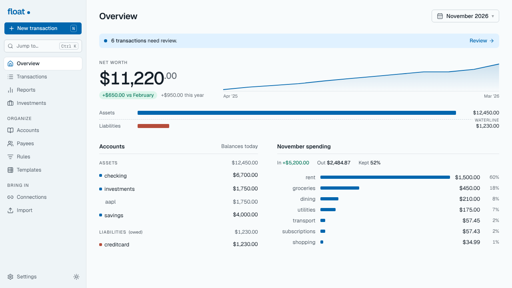
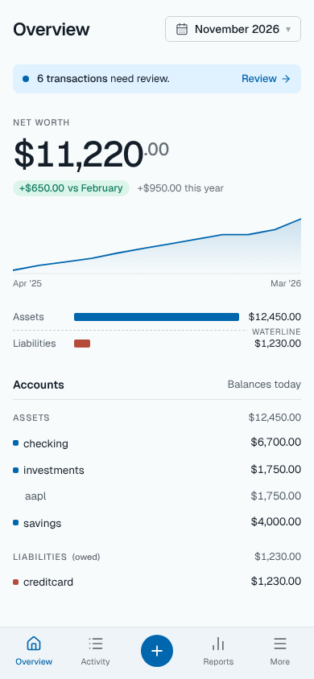
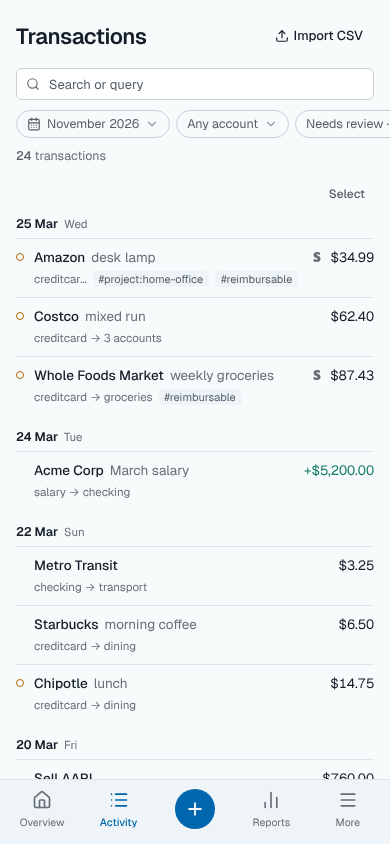
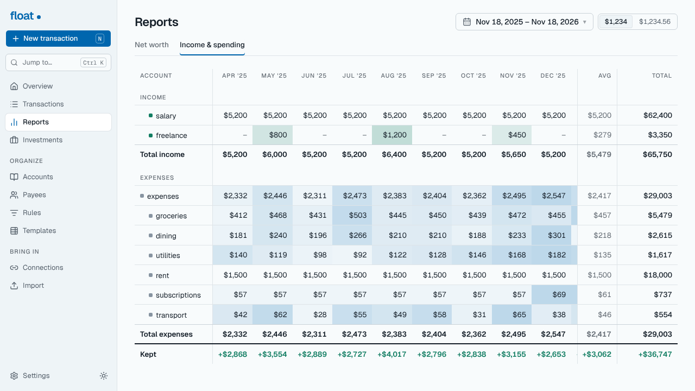
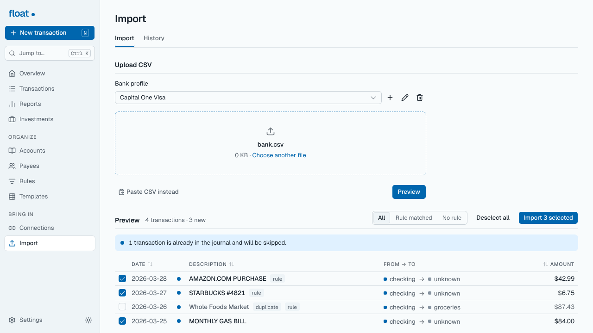

# float

float is a self-hostable personal finance manager built on top of [hledger](https://hledger.org/). Track your spending, net worth, and investments from a nice web UI, while all of your data lives in plain-text journal files that you own forever.



# Features

- Backed by [hledger](https://hledger.org/). All of your data is stored as plain-text journals, and hledger handles all of the accounting math, validation, and reporting, so your files are always valid hledger and work with any other hledger tool.
- Automatic snapshots of your data after every change, stored as commits in a git repository inside your data directory. Browse, diff, and restore old versions right from the UI.
- Import CSVs from your bank with reusable per-bank profiles, preview everything before it hits your journal, and skip duplicates automatically.
  - Plus, optionally connect your bank accounts via Stripe Financial Connections and have new transactions pulled in daily.
- Categorization rules automatically clean up payees and assign accounts and tags as transactions come in, or retroactively across your whole history.
- Reports for net worth over time and monthly income and spending.
- Investment tracking with lots, cost basis, returns, and allocation.

<p align="center">
  
  &nbsp;&nbsp;
  
</p>

## Screenshots

| | |
|---|---|
|  |  |
|  |  |

# Installation

The easiest way to run float is with Docker. The image bundles hledger, so there's nothing else to install. To get up and running quickly:

- Download a copy of the [docker-compose.yml](docker-compose.yml) file from this repository
- Change `FLOAT_AUTH_PASSPHRASE` to something secret, and optionally uncomment the Stripe and OpenRouter variables to enable those integrations
- Create an empty config file with `mkdir -p data && touch data/config.toml`
- Run `docker compose up -d` and you should be able to access float at `your-server.com:8080`

```yaml
services:
  float:
    image: ghcr.io/brendanv/float:latest
    container_name: float
    restart: unless-stopped
    ports:
      - "8080:8080"
    volumes:
      # Your journals, config.toml, and snapshot history live here.
      - ./data:/data
    environment:
      # Required to enable auth. Without it, anyone who can reach the server has full access.
      FLOAT_AUTH_PASSPHRASE: change-me
      # Optional: bank connections via Stripe Financial Connections.
      # STRIPE_SECRET_KEY: sk_live_...
      # STRIPE_PUBLISHABLE_KEY: pk_live_...
      # Optional: AI features via OpenRouter.
      # OPENROUTER_API_KEY: sk-or-...
      # OPENROUTER_MODEL: ...
```

If you'd rather build it yourself, install [mise](https://mise.jdx.dev/) and run:

```bash
mise install
mise run build
./floatd --data-dir ./data
```

## Bringing your existing journal

Already using hledger? Just add an `include` for your existing journal in `data/main.journal` and float will pick it up. New transactions that float writes go into monthly files like `data/2026/01.journal`, and get a short code like `(a1b2c3d4)` so float can find them again later. Any metadata float needs is stored in `float-*` tags, which are hidden in the UI.

# Configuration

`config.toml` can start out empty, and most settings (bank profiles, API keys, timezone) can be managed from the Settings and Import pages. A few things are configured via environment variables instead:

- `STRIPE_SECRET_KEY` and `STRIPE_PUBLISHABLE_KEY`: enables bank connections via Stripe.
- `OPENROUTER_API_KEY` (and optionally `OPENROUTER_MODEL`): enables the AI features.

You'll probably want to set `timezone = "America/New_York"` (or wherever you are) at the top of `config.toml` so that "today" means the same thing to float as it does to you.

## Authentication

float uses a single shared passphrase, set via the `FLOAT_AUTH_PASSPHRASE` environment variable. There are no per-user accounts: anyone with the passphrase gets full access.

- In the web UI, you log in with the passphrase once and get a long-lived session cookie.
- API clients send it as a bearer token: `Authorization: Bearer <passphrase>`.
- Changing the passphrase immediately logs out every existing session.

> [!WARNING]
> If `FLOAT_AUTH_PASSPHRASE` isn't set, auth is disabled entirely and anyone who can reach the server can see and edit your finances. Since there's only one passphrase, it's best to keep float on your home network or behind a VPN.

# Scripting and the API

float speaks gRPC, gRPC-Web, and Connect on the same port, with server reflection turned on, so tools like `buf curl` and `grpcurl` work without any local protos:

```bash
buf curl --protocol grpc --http2-prior-knowledge \
  --header "Authorization: Bearer $FLOAT_AUTH_PASSPHRASE" \
  --reflect-header "Authorization: Bearer $FLOAT_AUTH_PASSPHRASE" \
  http://localhost:8080/float.v1.LedgerService/GetBalances --data '{}'
```

If you're writing a script (or pointing an agent at float) to turn some export into transactions, use `ImportStructuredTransactions`. It validates the whole batch up front, supports dry runs, skips anything that's already in your journal so re-running it is safe, and the result can be undone just like a CSV import.

## Connecting an agent (MCP)

floatd serves a [Model Context Protocol](https://modelcontextprotocol.io) endpoint at `/mcp` (streamable HTTP), so agents like Claude Code can read and edit your ledger through a small set of tools: listing transactions, running read-only hledger reports, importing transactions (with dry runs), editing and deleting them, and categorization rules. With auth on, the endpoint takes the same passphrase as a bearer token (the web UI's cookie isn't accepted):

```bash
claude mcp add --transport http float http://localhost:8080/mcp \
  --header "Authorization: Bearer $FLOAT_AUTH_PASSPHRASE"
```

Other clients take the same URL and header in their MCP config. Tools are annotated as read-only or destructive, so a client can ask you before anything that deletes or overwrites data.

There's also `floatctl`, an admin CLI that operates on the data directory directly, which is handy for debugging, poking at config, or restoring snapshots without the server running. Run `go run ./cmd/floatctl help` to see everything it can do.

## Contributing

Contributions are welcome but no guarantees that they'll be accepted - I mostly built float for myself so I'm somewhat opinionated on how it should evolve :)

To get a dev environment going, run `mise run floatd` and `mise run web-dev` side by side. `mise run check-all` runs lint and tests, and `mise run ci` runs everything CI does.
