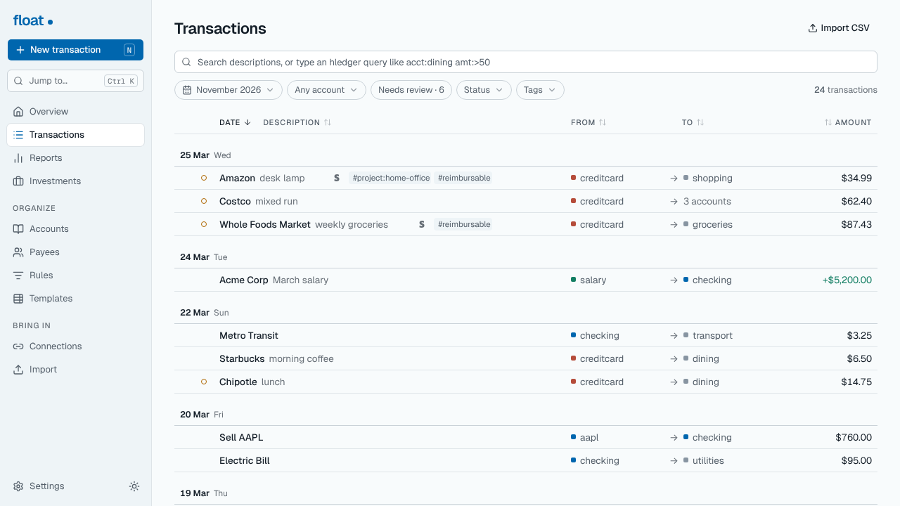
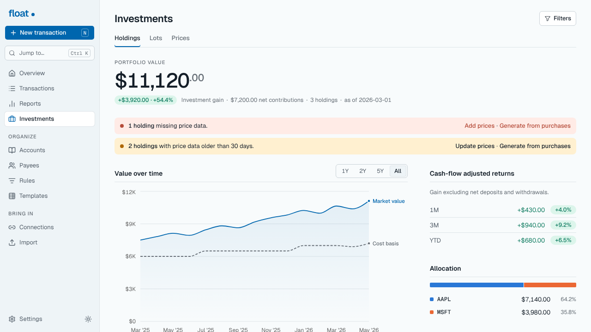
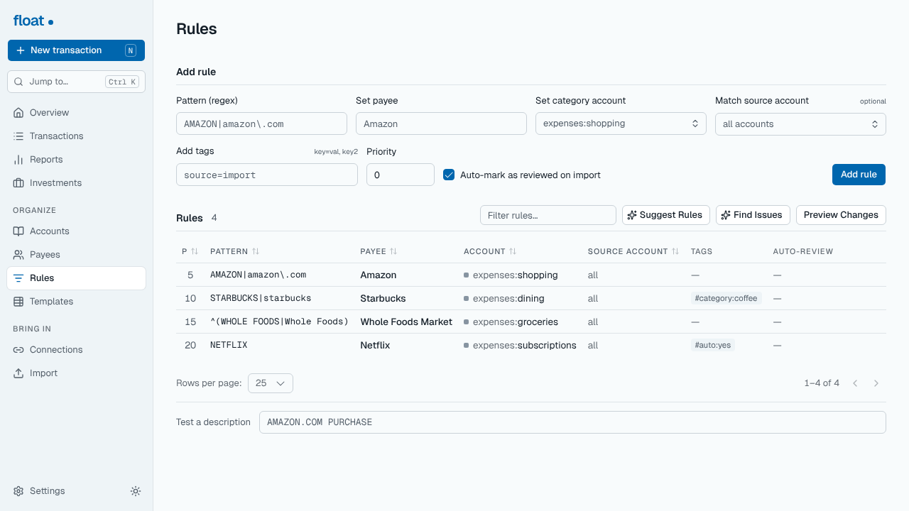

# float

A self-hostable personal finance manager built on [hledger](https://hledger.org/).

Your data stays in plain-text hledger journals. float adds the parts that
make plain-text accounting practical day to day: a web UI, CSV and bank
imports, categorization rules, investment tracking, and automatic snapshots.
hledger does all the accounting math, parsing, validation and reporting, so
your journal is always valid hledger and works with any other hledger tool.


## Features

- **Plain-text storage.** Transactions are written to monthly `.journal`
  files (`2026/01.journal`, …) that you can read, edit, grep and version
  yourself.
- **Every write is validated.** Mutations are serialized, checked with
  `hledger check`, and rolled back if they would break the journal.
- **Automatic snapshots.** Each successful write is committed to a git
  history inside the data directory (pure Go, no `git` binary required), and
  snapshots can be browsed, diffed and restored from the UI.
- **Imports.** Per-bank CSV profiles backed by hledger CSV rules, a preview
  with duplicate detection, import history with the original files kept, and
  one-click undo of a whole batch.
- **Bank connections.** Optional Stripe Financial Connections with a daily
  auto-import.
- **Categorization rules.** Regex rules that set payee, account and tags,
  applied on import or in bulk, with a preview before changes are written.
- **Reports.** Net worth over time, a monthly income and spending table,
  account registers and balance assertions.
- **Investments.** Holdings, lots, cost basis, cash-flow adjusted returns and
  allocation, with commodity prices entered by hand or backfilled from
  Alpha Vantage.
- **Quick entry.** Keyboard-first transaction entry, saved templates for
  recurring transactions, and bulk edit.
- **Optional AI helpers** (via OpenRouter): rule suggestions, rule conflict
  detection, and natural-language questions about your ledger.
- **API first.** Everything the UI does is available over a ConnectRPC API
  (gRPC, gRPC-Web and Connect on one port, with server reflection).

## Screenshots

| | |
|---|---|
|  **Transactions** — filter by date, account, status or any hledger query. |  **Reports** — monthly income and spending by account. |
|  **Investments** — portfolio value, returns and allocation. |  **Import** — preview a CSV before it touches your journal. |
|  **Rules** — categorize transactions automatically. | |

## Quick start

### Docker

```bash
mkdir -p data && touch data/config.toml
docker run -d --name float \
  -p 8080:8080 \
  -v "$PWD/data:/data" \
  -e FLOAT_AUTH_PASSPHRASE=change-me \
  ghcr.io/brendanv/float:latest
```

Open <http://localhost:8080> and log in with the passphrase.

### From source

Tool versions (Go, Bun, buf, hledger, …) are pinned with
[mise](https://mise.jdx.dev/).

```bash
mise install
mise run build                      # builds the web UI and ./floatd
mkdir -p data && touch data/config.toml
FLOAT_AUTH_PASSPHRASE=change-me ./floatd --data-dir ./data
```

`floatd` flags:

| Flag | Description |
|------|-------------|
| `--data-dir` | Path to the data directory (required). |
| `--addr` | Listen address. Overrides `server.port`; defaults to `:8080`. |
| `--verbose` | Debug logging, including every hledger invocation. |

## Data directory

```text
data/
├── config.toml           # server settings, bank profiles, integrations
├── main.journal          # include directives (created if missing)
├── accounts.journal      # account declarations
├── prices.journal        # commodity prices
├── rules/                # hledger CSV rules, one per bank profile
├── rules.json            # float categorization rules
├── templates.json        # saved transaction templates
└── 2026/01.journal       # transactions, one file per month
```

To use an existing hledger journal, point `main.journal` at it with an
`include` directive. Transactions written by float get an 8-character code,
e.g. `(a1b2c3d4)`, and float's own metadata is stored in `float-*` tags.

## Configuration

`config.toml` can start empty. Everything below is optional, and most of it
can also be managed from the Settings and Import pages.

```toml
timezone = "America/New_York"   # IANA name; defaults to UTC

[server]
port = 8080

[[bank_profiles]]
name = "Chase Checking"
rules_file = "rules/chase-checking.rules"   # relative to the data dir

[alpha_vantage]
api_key = "..."                 # enables price backfill

[ai]
model = ""                      # OpenRouter model ID; empty uses the default
prompt = ""                     # extra guidance for AI helpers

[portfolio]
excluded_symbols = []
excluded_account_prefixes = []
```

Environment variables:

| Variable | Purpose |
|----------|---------|
| `FLOAT_AUTH_PASSPHRASE` | Shared passphrase for the UI and API. **Auth is disabled when unset.** |
| `STRIPE_SECRET_KEY`, `STRIPE_PUBLISHABLE_KEY` | Enable Stripe Financial Connections. |
| `OPENROUTER_API_KEY` | Enable AI helpers. |
| `OPENROUTER_MODEL` | Override the AI model. |

## API

float exposes `float.v1.LedgerService` (see [`proto/float/v1/`](proto/float/v1/))
over h2c. With reflection enabled, no local protos are needed:

```bash
buf curl --protocol grpc --http2-prior-knowledge \
  --header "Authorization: Bearer $FLOAT_AUTH_PASSPHRASE" \
  --reflect-header "Authorization: Bearer $FLOAT_AUTH_PASSPHRASE" \
  http://localhost:8080/float.v1.LedgerService/GetBalances --data '{}'
```

Scripts and agents that turn exports into transactions should use
`ImportStructuredTransactions`: it validates the whole batch through hledger,
supports `dry_run`, skips transactions that are already on disk, and records
the batch so it can be undone.

## floatctl

`floatctl` is an admin and debug CLI that works directly on a data directory,
without a running server: inspecting and validating config, running hledger
reports, adding or importing transactions, managing categorization rules,
auditing journals, and listing or restoring snapshots.

```bash
go run ./cmd/floatctl help
```

## Development

```bash
mise run floatd      # floatd with hot reload (data dir from FLOAT_DATA_DIR)
mise run web-dev     # Vite dev server on :5173, proxying the API to :8080
mise run check-all   # lint + vet + tests
mise run ci          # everything CI runs
```

The backend is Go (`cmd/`, `internal/`) and the web UI is React + Vite +
TanStack + shadcn/ui (`web/`), embedded in the `floatd` binary. Architecture
notes for contributors are in [`CLAUDE.md`](CLAUDE.md) and the per-package
`CLAUDE.md` files.

The screenshots above are generated from mocked API data:

```bash
cd web && bash capture-screenshots.sh /tmp/screenshots
```
